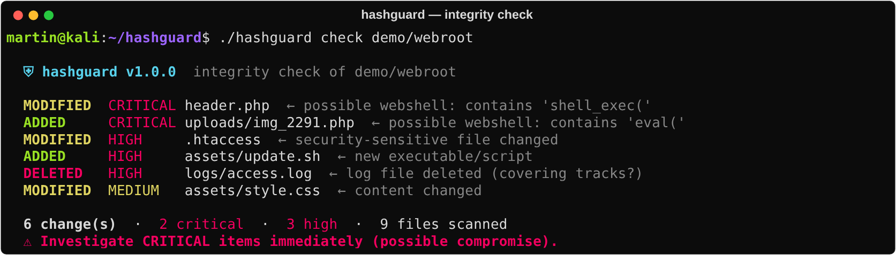
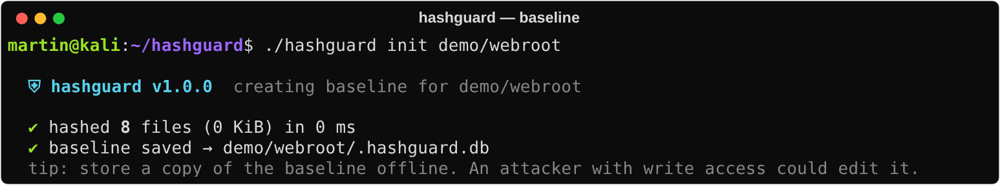
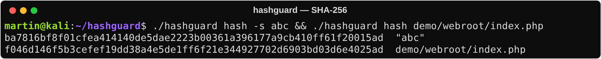
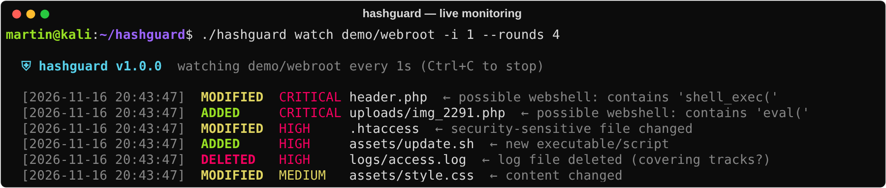

<div align="center">

# ⛨ hashguard

**A lightweight File Integrity Monitor (FIM) in C++17 with SHA-256 written from scratch. It catches webshells, backdoors and tampering.**




</div>

---

## 📖 What is File Integrity Monitoring?

After attackers break into a web server, they usually **change files**: they upload a webshell,
inject a line into an existing page, weaken `.htaccess`, drop a persistence script, and delete logs.

A **File Integrity Monitor** answers one question: *"What changed since the last known-good state?"*
It hashes every file into a trusted **baseline**, then later re-hashes and compares. Tools like
Tripwire, OSSEC and Wazuh FIM work this way. hashguard is my small, readable version of it.

## ✨ Features

- 🔐 **SHA-256 implemented from scratch** (FIPS 180-4) and verified against **official NIST test vectors**
- 📸 **Baseline → check → accept** workflow
- 👁️ **Live `watch` mode** with timestamped alerts
- 🧠 **Risk scoring** for every change, not just "file changed":

| Risk | Example |
|---|---|
| 🟣 CRITICAL | `.php/.jsp/.aspx` containing webshell signatures (`eval(`, `base64_decode(`, `shell_exec(`, `system($_`...) |
| 🔴 HIGH | `.htaccess`, `sudoers`, `authorized_keys`, `sshd_config` changed · new `.exe/.ps1/.sh` · new server-side script · **log file deleted** |
| 🟡 MEDIUM | regular content change, new or removed file |
| 🔵 LOW | volatile files (`.tmp`, `.cache`, growing logs) |

- 🤖 **Automation-friendly:** `--json` output and exit codes `0` clean · `1` changes · `2` critical
- 🚫 Excludes `.git`, `node_modules`, `__pycache__` by default (`--exclude` to add more)
- 📦 Single binary with **zero dependencies**, using only `std::filesystem`

## 📸 Screenshots

<table>
<tr><td width="50%"><b>Create a baseline</b><br></td>
<td width="50%"><b>Hash files / strings</b><br></td></tr>
</table>

**Live monitoring while an "attack" happens**



---

## 🚀 Tutorial

### 1. Build

```bash
git clone https://github.com/Martun1/hashguard.git
cd hashguard
cmake -S . -B build -DCMAKE_BUILD_TYPE=Release
cmake --build build --config Release
ctest --test-dir build -C Release      # runs the NIST SHA-256 vectors
```

The binary is `build/hashguard` (Linux/macOS) or `build\Release\hashguard.exe` (Windows / Visual Studio).
CLion users can open the folder directly.

### 2. Create a demo web server

```bash
python3 demo/simulate_attack.py setup      # creates demo/webroot with 8 files
```

### 3. Take a trusted baseline

```bash
./build/hashguard init demo/webroot
```

This writes `demo/webroot/.hashguard.db`, a readable text file with one `sha256  size  path` line per file.

> 🔒 **Real world:** keep a copy of the baseline **off the server** (or use `--db /secure/path`).
> An attacker with write access could otherwise update it to hide their changes.

### 4. Simulate an attack

```bash
python3 demo/simulate_attack.py attack
```

This drops a fake webshell into `uploads/`, injects a line into `header.php`, weakens `.htaccess`,
adds `assets/update.sh`, deletes `logs/access.log`, and makes one harmless CSS change.
*Everything is harmless: the "webshell" is a PHP comment that never executes.*

### 5. Detect it

```bash
./build/hashguard check demo/webroot
echo $?        # 2 → critical findings
```

Notice how the harmless CSS edit is **MEDIUM** while the two PHP files are **CRITICAL**. Risk scoring
helps you start your investigation in the right place.

### 6. Monitor live

```bash
./build/hashguard watch demo/webroot -i 5
```

Leave it running in one terminal and edit files in another.

### 7. Approve legitimate changes

After a planned deployment:

```bash
./build/hashguard accept demo/webroot
```

### 8. Automate it

**Linux cron**, every 15 minutes, logging only when something changed:

```cron
*/15 * * * * /opt/hashguard/hashguard check /var/www/html --json --db /root/www.hgdb >> /var/log/hashguard.json || true
```

**Windows Task Scheduler:**

```powershell
hashguard.exe check C:\inetpub\wwwroot --json --db C:\secure\iis.hgdb
```

---

## 🧠 How SHA-256 works (short version)

1. **Pad** the message: append `1`, then zeros, then the 64-bit length, so the total is a multiple of 512 bits.
2. Split into **64-byte blocks** and expand each into 64 words (`σ0`, `σ1` rotations and shifts).
3. Run **64 rounds** of the compression function on 8 working variables (`a..h`) with the constants `K[i]`
   (fractional parts of the cube roots of the first 64 primes).
4. Add the result to the running state. After the last block, the 8 × 32-bit state **is** the hash.

See [`src/sha256.hpp`](src/sha256.hpp): about 100 lines, commented, and streaming in 64 KiB chunks, so
huge files never load fully into RAM.

## 🧱 Project structure

```
hashguard/
├── src/sha256.hpp            # SHA-256 from scratch
├── src/main.cpp              # FIM: scan, baseline, diff, risk scoring, watch
├── tests/test_sha256.cpp     # NIST/FIPS 180-4 vectors (incl. 1,000,000 × 'a')
├── demo/simulate_attack.py   # safe attack simulation for the tutorial
└── .github/workflows/ci.yml  # build + test on Linux/Windows/macOS + attack detection
```

## 🗺️ Roadmap

- [ ] Permission/owner change detection (chmod 777, SUID bits)
- [ ] HMAC-signed baseline (tamper-evident database)
- [ ] Multithreaded hashing
- [ ] Send alerts to syslog / webhook

---

<div align="center">
Made by <a href="https://github.com/Martun1">Martin Ivanov</a> · eJPT · CCNA · Computer Science @ NBU
</div>
